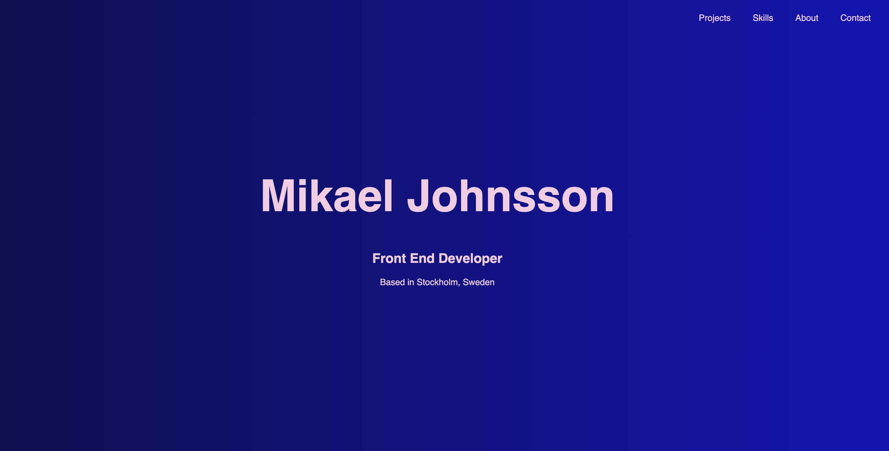

# Mikael Johnsson — Portfolio

**Live site:** [www.mikael-johnsson.se](https://www.mikael-johnsson.se)



This is the source code for my personal portfolio. I'm a frontend developer based in Stockholm, Sweden. The site shows a selection of my projects, my technical skills and some background about me. My CV is available to download in English and Swedish.

## About me

I'm studying frontend development at **Medieinstitutet** in Stockholm and graduate in spring 2027. Before that I spent about ten years in film and TV production, where I picked up experience in project management, client communication and working in small teams that changed often.

I work mainly with **TypeScript, React, Next.js and Node.js**, and I'm happy to adapt to other tech stacks.

## Featured projects

| Project | Description | Tech | Links |
| --- | --- | --- | --- |
| **Wedding site** | Wedding website with RSVP, guest list management and an email modal for contacting the toastmaster | TypeScript, Next.js, MongoDB | [Live](https://www.bernozzi.se) · [Code](https://github.com/mikael-johnsson/wedding-site) |
| **World Cup betting app** | Bet on World Cup matches and compete against friends in private groups | TypeScript, Next.js, MongoDB | [Live](https://world-cup-bet.vercel.app/) · [Code](https://github.com/mikael-johnsson/world-cup-bet) |
| **The Iconic Series** | E-commerce site with a cart, checkout and form validation. Built as a group project | TypeScript, SCSS, Vercel | [Live](https://webbshop-psi.vercel.app/) · [Code](https://github.com/mikael-johnsson/webbshop) |
| **Running map** | Click on a map to draw running routes, get exact distances and save your favourite routes | TypeScript, Map API | [Live](https://running-map-one.vercel.app/) · [Code](https://github.com/mikael-johnsson/running-map) |

## Built with

- **HTML5**: semantic, single-page layout with anchor navigation
- **SCSS**: compiled to `styles.css`, with shared colour variables in `scss/_variables.scss`
- **Responsive design**: breakpoints at 1200px, 991px and 768px
- **GitHub Pages**: hosting, with a custom domain set up through `CNAME`

The site uses no frameworks or build tooling. It is deliberately lightweight and fast to load.

## Project structure

```
.
├── index.html            # Page markup
├── styles.scss           # Main stylesheet (source)
├── styles.css            # Compiled stylesheet (served)
├── scss/
│   └── _variables.scss   # Colour palette
├── assets/
│   ├── CV_*.pdf          # Downloadable CVs (English / Swedish)
│   ├── favicons/         # Favicons and web manifest
│   └── images/           # Project screenshots
└── CNAME                 # Custom domain for GitHub Pages
```

## Running locally

Clone the repository and open `index.html` in a browser, or serve it locally:

```bash
git clone https://github.com/mikael-johnsson/portfolio_dev.git
cd portfolio_dev
npx serve .
```

If you edit the styles, recompile the SCSS:

```bash
npx sass styles.scss styles.css
```

## Contact

- **Email:** mikaeljohanjohnsson [at] gmail.com
- **LinkedIn:** [linkedin.com/in/mikael-johnsson](https://www.linkedin.com/in/mikael-johnsson/)
- **GitHub:** [github.com/mikael-johnsson](https://github.com/mikael-johnsson)
